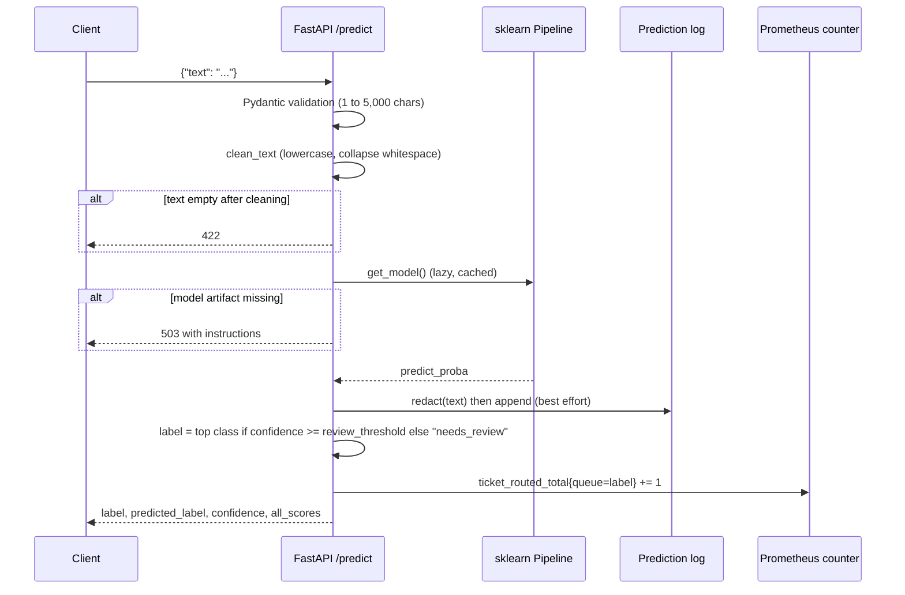

# Automated Support Ticket Classification

Technical documentation for [raviteja311/Automated-Support-Ticket-Classification](https://github.com/raviteja311/Automated-Support-Ticket-Classification)

| | |
|---|---|
| Package | `automated_support_ticket_classification` v1.0.0 (single-sourced in `__version__`, also reported by the API) |
| Language | Python 3.12 (`requires-python >= 3.12`) |
| Licence | MIT (code), CC BY 4.0 (banking77 corpus, by PolyAI) |
| Author | Jetti Raviteja |
| Status | Runs locally. A Render blueprint exists, but no public instance is deployed. |

> **About the figures in this document.** Every number quoted here comes from a file committed to the repository (`metrics/*.json`, `reports/*.csv`, `docs/experiments.md`) or from the repository README, and the source is named next to it. See [Known discrepancies](#known-discrepancies-in-the-repository).

---

## Table of contents

1. [Project overview](#1-project-overview)
2. [Problem statement](#2-problem-statement)
3. [Objectives](#3-objectives)
4. [Key features](#4-key-features)
5. [System architecture](#5-system-architecture)
6. [Technology stack](#6-technology-stack)
7. [Repository structure](#7-repository-structure)
8. [Implementation details](#8-implementation-details)
9. [Results and evaluation](#9-results-and-evaluation)
10. [Installation and setup](#10-installation-and-setup)
11. [Usage guide](#11-usage-guide)
12. [Configuration reference](#12-configuration-reference)
13. [Testing and CI](#13-testing-and-ci)
14. [Deployment](#14-deployment)
15. [Design decisions](#15-design-decisions)
16. [Limitations](#16-limitations)
17. [Future enhancements](#17-future-enhancements)
18. [Licence and attribution](#18-licence-and-attribution)

---

## 1. Project overview

This project is an end-to-end MLOps service that routes customer support messages into one of five support queues:

| Queue | Meaning (from `data/banking77.py`) |
|---|---|
| `billing` | Money moved wrongly, or a charge needs explaining or reversing |
| `technical` | Something did not work: declined, failed, unrecognised by a device |
| `account` | Identity, credentials, limits, and the account's lifecycle |
| `card_delivery` | A physical card needs to arrive |
| `general` | An informational question with no fault to fix |

For each message, the API returns a routed label, the model's top prediction, a confidence score, and the full probability distribution over all five queues.

The model is deliberately simple: a TF-IDF vectoriser feeding a logistic regression classifier, packaged as a single scikit-learn `Pipeline` that trains in seconds. The project's emphasis is the engineering around the model, which includes a reproducible DVC pipeline, MLflow experiment tracking with a gated model registry, statistical evaluation (bootstrap confidence intervals, McNemar tests), a FastAPI service with a confidence-based human-review route, PII redaction in the prediction log, Evidently drift monitoring, Prometheus metrics, Docker packaging, and GitHub Actions CI.

The training data is **banking77**, a public corpus of 13,083 real customer-support messages from a digital bank, labelled with 77 fine-grained intents. The project folds those 77 intents into the five queues with a hand-written, documented mapping.

---

## 2. Problem statement

Support teams receive a continuous stream of free-text messages that must reach the right team before anyone can act on them. Manual triage is slow and inconsistent, and a misrouted message costs a hand-off. An automated router has to do more than predict a label:

- It must be **trustworthy at the margin**. A router that is unsure should say so and hand the message to a person rather than guess.
- It must be **measurable honestly**. Accuracy alone can hide a collapsed minority class, and a single score on one test split can move by about a point purely from which rows were sampled (shown in experiment E8).
- It must be **safe to operate**. Logging production traffic for monitoring creates a privacy liability if identifiers such as card numbers, emails, or Indian identifiers (PAN, UPI, Aadhaar, IFSC) are written to disk.
- It must be **monitored after deployment**. A service can keep returning HTTP 200 while the traffic it sees drifts away from the training data.
- It must be **reproducible**. Anyone should be able to rebuild the exact data, model and metrics from the code.

A further practical problem was finding real data. The repository documents that the CFPB consumer-complaints database was evaluated first and rejected because neither its bulk export nor its API exposes complaint narratives, leaving no text to classify. banking77 was chosen instead.

---

## 3. Objectives

Derived from the README, code and experiment log:

1. Classify support messages into five queues and return calibrated-style probabilities, not just a label.
2. Train on real, human-written support text, with the label mapping documented and its borderline calls marked.
3. Make the pipeline fully reproducible with DVC, from data download to evaluation reports.
4. Track experiments in MLflow and promote models only through an explicit, metric-based gate.
5. Report results with context: a majority-class floor, alternative models, confidence intervals and significance tests.
6. Serve predictions through a validated REST API with a browser test page, health checks and Prometheus metrics.
7. Route low-confidence predictions to human review, with a measured coverage versus accuracy trade-off.
8. Log predictions for drift monitoring without retaining personal identifiers, and cap how long raw traffic is kept.
9. Enforce quality with automated tests, formatting and linting in CI, plus a Docker build and container smoke test.

---

## 4. Key features

Each feature below is implemented in the repository. The file that implements it is listed.

| Feature | Implementation |
|---|---|
| Five-queue text classifier (TF-IDF with unigrams and bigrams, logistic regression) | `models/train.py` |
| Optional calibrated LinearSVC (`CalibratedClassifierCV`, sigmoid or isotonic) selectable by config | `models/train.py`, `params.yaml` |
| banking77 download with retry, exponential backoff and atomic writes | `data/banking77.py` |
| 77-intent to 5-queue mapping, with a test enforcing completeness | `data/banking77.py`, `tests/test_data.py` |
| Seeded synthetic template generator for offline builds | `data/generate.py` |
| Official banking77 split or stratified random split | `data/preprocess.py` |
| Eight-stage DVC pipeline | `dvc.yaml` |
| MLflow run tracking and model registration | `models/train.py`, `models/registry.py` |
| Promotion gate on macro F1, corpus-aware, using MLflow aliases | `models/registry.py`, `models/promote.py` |
| Per-class metrics, confusion matrix, error list, coverage vs accuracy curve | `models/evaluate.py` |
| Baselines with bootstrap 95% CIs and a McNemar test | `models/baselines.py`, `models/stats.py` |
| 5-way vs 77-way granularity study | `models/granularity.py` |
| Pre-registered model comparison with expected calibration error (ECE) and reliability diagram | `models/compare.py`, `docs/model-decision.md` |
| India robustness evaluation stage (English, Hinglish, short or misspelled) | `models/eval_india.py` |
| Inter-annotator tooling for the label mapping (Cohen's and Fleiss' kappa) | `data/mapping_validation.py` |
| FastAPI service: `/`, `/ui`, `/health`, `/predict`, `/docs`, `/metrics` | `api/app.py` |
| Human-review route (`needs_review`) below a configurable confidence | `api/app.py`, `params.yaml` |
| Self-contained HTML test page, no external assets | `api/ui.py` |
| PII redaction and size-based rotation of the prediction log | `monitoring/prediction_log.py` |
| Evidently drift monitor with a minimum-sample gate | `monitoring/drift.py` |
| Prometheus RED metrics plus a `ticket_routed_total` counter by queue | `api/app.py`, `prometheus.yml` |
| Multi-stage Docker image with the model baked in at build time | `Dockerfile` |
| API plus Prometheus via Docker Compose | `docker-compose.yml` |
| CI: format check, lint, tests, Docker build, container smoke test | `.github/workflows/ci.yml` |
| Manual smoke test workflow for a deployed URL | `.github/workflows/smoke.yml` |
| Latency and PII recall measurement scripts | `scripts/benchmark_latency.py`, `scripts/pii_recall.py` |
| One-command local launcher for Windows | `run.ps1`, `run.cmd` |

---

## 5. System architecture

### 5.1 High-level view

```mermaid
flowchart LR
    subgraph Offline["Offline: DVC pipeline (developer machine)"]
        A[banking77 CSVs<br/>or synthetic generator] --> B[generate]
        B --> C[preprocess]
        C --> D[train]
        D -->|model.joblib| E[evaluate]
        D --> F[baselines]
        D --> G[granularity]
        D --> H[eval_india]
        D -. log + register .-> M[(MLflow<br/>runs and registry)]
        M -. promote.py gate .-> M
    end

    subgraph Serving["Serving: Docker image"]
        I[FastAPI app] --> J[TF-IDF + LogReg pipeline]
        I --> K[Prediction log<br/>redacted, rotated]
        I --> L[/metrics endpoint/]
    end

    D -->|artifact baked in at build| J
    L --> P[(Prometheus)]
    K --> Q[Drift monitor<br/>Evidently]
    C -->|train.csv as reference| Q
```

### 5.2 Request lifecycle (`POST /predict`)



### 5.3 DVC pipeline stages

| Stage | Command module | Main inputs | Outputs |
|---|---|---|---|
| `generate` | `data.generate` | `data.source`, `data.n_samples`, `data.random_state` | `data/raw/tickets.csv` |
| `preprocess` | `data.preprocess` | raw CSV, `data.split`, `data.test_size` | `data/processed/train.csv`, `test.csv` |
| `train` | `models.train` | processed data, `model.*` params | `models/model.joblib` |
| `evaluate` | `models.evaluate` | model, test set | `metrics/metrics.json`, confusion matrix (CSV, PNG), `errors.csv`, coverage vs accuracy (CSV, PNG) |
| `baselines` | `models.baselines` | model, train and test sets | `metrics/baselines.json` |
| `eval_india` | `models.eval_india` | model, `metrics.json`, `data/india_eval/india_messages.csv` | `metrics/india.json` |
| `granularity` | `models.granularity` | model, train and test sets | `metrics/granularity.json` |

Metrics and reports are declared with `cache: false`, so Git rather than DVC owns them and metric changes appear in pull-request diffs. Data and the model artifact are DVC-tracked and Git-ignored.

Two analysis tools are deliberately run by hand rather than as stages: `models.compare` (model comparison under a pre-written rule) and `data.mapping_validation` (annotator agreement). The drift monitor (`monitoring.drift`) is also run by hand.

---

## 6. Technology stack

Versions are taken from the `requirements*.txt` pins.

| Layer | Tools |
|---|---|
| Language | Python 3.12 |
| ML | scikit-learn 1.5.2 (TfidfVectorizer, LogisticRegression, LinearSVC, CalibratedClassifierCV, ComplementNB, DummyClassifier), pandas 2.2.3, NumPy, SciPy (< 1.18), joblib 1.4.2 |
| Statistics | statsmodels 0.15.0 (McNemar, Fleiss' kappa), NumPy bootstrap |
| Configuration | PyYAML 6.0.2, pydantic 2.9.2 (typed config models) |
| Pipeline and data versioning | DVC 3.55.2 |
| Experiment tracking and registry | MLflow 2.18.0 (local tracking, registry aliases) |
| Serving | FastAPI 0.115.5, uvicorn 0.32.1 |
| Observability | prometheus-fastapi-instrumentator 7.0.0, prometheus_client, Prometheus (Docker image `prom/prometheus:v3.15.1`) |
| Drift monitoring | Evidently 0.7.23 |
| Reporting | matplotlib 3.11.1 |
| Testing and quality | pytest 8.3.3, httpx 0.27.2, ruff 0.7.4, pre-commit 4.0.1 |
| Containers | Docker (multi-stage, `python:3.12-slim`), Docker Compose |
| CI/CD | GitHub Actions |
| Deployment target (prepared, not deployed) | Render (`render.yaml`) |

Three requirement files separate concerns:

- `requirements.txt`: direct runtime and pipeline dependencies, including MLflow and DVC.
- `requirements-dev.txt`: adds test, lint and analysis tools (Evidently, matplotlib, statsmodels).
- `requirements-serve.txt`: the lean set installed in the Docker image. It excludes MLflow and DVC, which are not needed at serving time.

`requirements.lock.txt` pins the full transitive graph, captured with `pip freeze` on Windows with Python 3.12.10.

---

## 7. Repository structure

```text
Automated-Support-Ticket-Classification/
├── src/automated_support_ticket_classification/
│   ├── config.py               # Typed params.yaml loader (pydantic)
│   ├── logger.py               # Shared stdout logger
│   ├── data/
│   │   ├── banking77.py        # Download, cache, 77-to-5 intent mapping
│   │   ├── generate.py         # Stage 1: banking77 or synthetic templates
│   │   ├── preprocess.py       # Stage 2: clean_text, official/random split
│   │   └── mapping_validation.py  # Annotation sheet, kappa, sensitivity
│   ├── models/
│   │   ├── train.py            # Stage 3: pipeline build, MLflow, registration
│   │   ├── evaluate.py         # Stage 4: metrics and reports
│   │   ├── baselines.py        # Stage 5: floor and alternative models
│   │   ├── eval_india.py       # Stage 6: India robustness set
│   │   ├── granularity.py      # Stage 7: 5-way vs 77-way
│   │   ├── stats.py            # Bootstrap CI, McNemar
│   │   ├── compare.py          # Pre-registered LogReg vs calibrated SVC
│   │   ├── registry.py         # MLflow registry and promotion gate
│   │   └── promote.py          # CLI for the gate
│   ├── api/
│   │   ├── app.py              # FastAPI application
│   │   ├── schemas.py          # Request and response models
│   │   └── ui.py               # Inline HTML test page
│   └── monitoring/
│       ├── prediction_log.py   # PII redaction and log rotation
│       └── drift.py            # Evidently drift report and summary
├── tests/                      # 14 test modules, 145 tests, fixtures
├── scripts/
│   ├── benchmark_latency.py    # In-process, model-only and HTTP latency
│   └── pii_recall.py           # Redaction recall on hand-written cases
├── metrics/                    # Git-tracked JSON metrics, including latency
├── reports/                    # Git-tracked confusion matrix, errors, coverage
├── docs/
│   ├── experiments.md          # Experiment log E1 to E9
│   ├── model-decision.md       # Decision rule template for compare.py
│   ├── mapping/                # Annotation sheet and instructions
│   └── *-MLOps-Guide-CORRECTED.pdf  # 49-page build guide
├── data/
│   ├── raw/, processed/        # DVC outputs (Git-ignored)
│   └── india_eval/             # India robustness set (header only so far)
├── models/                     # model.joblib (Git-ignored)
├── .github/workflows/          # ci.yml, smoke.yml
├── dvc.yaml, dvc.lock, params.yaml
├── prometheus/rules.yml        # Prometheus alert rules (review rate, 5xx rate)
├── Dockerfile, docker-compose.yml, prometheus.yml, render.yaml
├── pyproject.toml, requirements*.txt
├── run.ps1, run.cmd            # Windows launcher
└── README.md, CONTRIBUTING.md, LICENSE
```

---

## 8. Implementation details

### 8.1 Configuration (`config.py`)

All tunable values live in `params.yaml` and are loaded through pydantic models (`DataConfig`, `ModelConfig`, `EvaluateConfig`, `MonitoringConfig`, `ServeConfig`). Relative paths are resolved against the project root, which is derived from the location of `config.py`, so modules work regardless of the current working directory. Newer fields carry defaults so older `params.yaml` files still load. DVC declares the relevant keys as stage params, so changing one reruns only the affected stages.

### 8.2 Data acquisition (`data/banking77.py`, `data/generate.py`)

**banking77 (default).** The loader downloads `train.csv` and `test.csv` (about 1 MB) from the PolyAI GitHub repository into `data/external/`. Each download:

- retries up to 4 times with exponential backoff starting at 2 seconds;
- writes to a `.part` file and renames only on success, so a truncated file is never mistaken for a cached one.

Rows are tagged with their source file (`split`) and keep the original 77-way `intent`. The `label` column comes from `INTENT_MAP`, a dictionary that assigns each of the 77 intents to exactly one queue. Borderline assignments are commented in the source (for example, `pending_*` intents go to `billing`, `beneficiary_not_allowed` to `technical`, `card_about_to_expire` to `card_delivery`). If the upstream corpus ever gains an unmapped intent, loading raises a `ValueError` rather than silently dropping rows. The natural class imbalance is kept on purpose.

Intents per queue under the current mapping: billing 25, account 19, technical 14, general 13, card_delivery 6.

**Synthetic (offline option).** `generate()` builds messages from five templates per class with random fillers, injecting 10% label noise. It is seeded for reproducibility and used when `data.source: synthetic`, for example to build without network access.

### 8.3 Preprocessing (`data/preprocess.py`)

`clean_text()` lowercases and collapses whitespace. The same function is imported by the API, so training and serving normalise text identically, which avoids train/serve skew.

`split_frame()` supports two strategies:

- `official`: uses banking77's published files (10,003 train and 3,080 test rows), so results are comparable with the literature. Fails loudly if the data has no `split` column.
- `random`: stratified `train_test_split` by `test_size` and `random_state`. Required for synthetic data.

### 8.4 Model (`models/train.py`)

```python
Pipeline([
    ("tfidf", TfidfVectorizer(max_features=5000, ngram_range=(1, 2))),
    ("clf",   LogisticRegression(C=1.0, max_iter=1000)),
])
```

`model.type: linearsvc_calibrated` swaps the classifier for `CalibratedClassifierCV(LinearSVC(...), method=sigmoid|isotonic, cv=5)`, which provides `predict_proba` for the API.

The whole pipeline is saved as one `joblib` artifact. When MLflow is available and `DISABLE_MLFLOW` is not `1`, training logs params and metrics to the `ticket-triage` experiment, logs the model with `mlflow.sklearn.log_model`, and registers a new version of `ticket-classifier`.

### 8.5 Model registry and promotion gate (`models/registry.py`, `models/promote.py`)

Every training run registers a version, tagged with its `accuracy`, `f1_macro` and `data_source`. Promotion is a separate step that moves the MLflow `production` alias, which makes rollback the same operation in reverse.

`promote_if_better()` rules:

| Situation | Outcome |
|---|---|
| No production version yet | Promote |
| Incumbent trained on a different corpus | Promote (scores are not comparable) |
| Candidate macro F1 greater than incumbent | Promote |
| Tie or regression | Keep incumbent |

`promote.py` exits with code 0 when it promotes and 2 when it does not, so a CI step can branch on the result. The gate metric is macro F1 rather than accuracy because accuracy can rise while a minority class collapses. The corpus check was added after experiment E4 showed the gate comparing a real-data score with a synthetic-data score.

### 8.6 Evaluation (`models/evaluate.py`, `models/stats.py`)

The `evaluate` stage writes:

- `metrics/metrics.json`: accuracy, macro F1 and the full per-class `classification_report`;
- `reports/confusion_matrix.csv` and `.png`;
- `reports/errors.csv`: every misclassified test row with its confidence and original intent, least confident first;
- `reports/coverage_accuracy.csv` and `.png`: for thresholds 0.30 to 0.95, the share auto-routed, the accuracy on that share, and the count sent to review.

`stats.py` provides:

- `bootstrap_f1_ci`: percentile bootstrap (1,000 resamples by default, seeded) over (true, predicted) pairs. It captures test-set sampling noise, not training variance.
- `mcnemar_p`: exact McNemar test on the 2x2 table of which model was right, for paired comparison on the same rows.

### 8.7 Baselines (`models/baselines.py`)

Fits a majority-class `DummyClassifier`, LinearSVC, ComplementNB and every other model type `train.py` can ship, each reusing `build_pipeline` with only the classifier swapped so the vectoriser is identical. The production row is the shipped artifact, not a refit. The report flags `production_beaten: true` when the best alternative wins by more than 1 point of macro F1, but it never changes the production model itself.

### 8.8 Granularity study (`models/granularity.py`)

Trains the same pipeline on the 77 intents, folds its predictions back into queues through `INTENT_MAP`, and compares with the direct 5-way model using bootstrap CIs and McNemar. This tests whether predicting fine-grained intents and mapping afterwards would be a better design.

### 8.9 Pre-registered model comparison (`models/compare.py`)

Compares `logreg` with `linearsvc_calibrated` on macro F1 (with CI), McNemar p, expected calibration error (10 equal-width bins) and single-message `predict_proba` latency, and draws a reliability diagram. The script refuses to run while `docs/model-decision.md` contains `TODO`, and records the SHA-256 of that file in its output, so the decision rule is provably written before the numbers are seen.

### 8.10 India robustness stage (`models/eval_india.py`)

Scores the production model on a hand-written set of Indian-banking messages (UPI, IMPS, NEFT, KYC, Hinglish), overall and by `language_style`, and reports the macro F1 drop against the banking77 test score. Rows are validated strictly. When the CSV is empty, the stage writes `{"status": "no_messages_yet"}` instead of failing, so `dvc repro` keeps working.

### 8.11 Mapping validation (`data/mapping_validation.py`)

Three sub-commands:

- `sheet`: writes a blind annotation sheet (each intent with three example messages, no answers shown).
- `agree`: reads completed sheets from `docs/mapping/annotations/`, computes pairwise Cohen's kappa and Fleiss' kappa, lists disputed intents, and writes a majority-vote mapping (ties keep the original choice).
- `sensitivity`: retrains under the majority-vote mapping and reports the change in macro F1.

### 8.12 API (`api/app.py`, `api/schemas.py`, `api/ui.py`)

| Endpoint | Method | Purpose |
|---|---|---|
| `/` | GET | Service info and links |
| `/ui` | GET | HTML test page (excluded from the OpenAPI schema) |
| `/health` | GET | Liveness, returns `{"status": "ok"}` |
| `/predict` | POST | Classification |
| `/docs` | GET | Swagger UI generated by FastAPI |
| `/metrics` | GET | Prometheus metrics |

Behaviour worth noting:

- **Validation.** `text` must be 1 to 5,000 characters (`MAX_TEXT_LENGTH`). Whitespace-only input passes the length check but is rejected with 422 after cleaning.
- **Lazy model loading.** `get_model()` is wrapped in `lru_cache`. A missing artifact raises `ModelUnavailableError`, mapped to HTTP 503 with instructions. Because `lru_cache` does not cache exceptions, the service recovers without a restart once the file appears.
- **Human review.** If the top probability is below `serve.review_threshold`, `label` becomes `needs_review` while `predicted_label` and `all_scores` still carry the model's suggestion. The default `0.0` disables this route.
- **Metrics.** `prometheus-fastapi-instrumentator` adds request rate, error and latency metrics. A custom counter `ticket_routed_total{queue=...}` counts answers by routed queue, so the review rate can be computed in PromQL.
- **Configuration.** `params.yaml` is read once per process through a cached `get_config()`, not on every request, so changing the review threshold or the log settings needs a restart.
- **Prediction logging.** The model's top prediction (not the routing decision) is logged with the redacted text. Logging is best effort: a failure only logs a warning and never fails the request.
- **Test page.** `ui.py` holds the page as an inline string with no CDN or build step, so it works offline and inside the container.

### 8.13 Prediction log: redaction and rotation (`monitoring/prediction_log.py`)

Each prediction is appended to `data/predictions.jsonl` after regex redaction, applied in a deliberate order:

| Order | Identifier | Placeholder |
|---|---|---|
| 1 | Email | `[email]` |
| 2 | UPI ID (for example `name@okaxis`) | `[upi]` |
| 3 | PAN (for example `ABCDE1234F`, any case) | `[pan]` |
| 4 | IFSC (for example `SBIN0001234`, any case) | `[ifsc]` |
| 5 | Runs of 8 or more digits, optionally spaced or dashed, with optional `+` (card, account, Aadhaar, phone) | `[number]` |
| 6 | Card fragments (`ending 4321`, `xxxx4321`) | context kept, digits become `[number]` |

Short numbers such as amounts and order IDs are kept because they carry routing signal. Placeholders replace values instead of deleting them so the text keeps its shape for the drift monitor.

The log rotates before a write would push it past `max_bytes` (5 MB by default), keeping `backup_count` (3) rotated copies, so raw traffic is not retained indefinitely.

Appends are serialised by a module-level lock, because `/predict` is a sync endpoint that FastAPI runs in a thread pool and concurrent rotations would otherwise lose lines. The lock covers threads in one process only; several uvicorn workers or replicas writing the same file are not supported.

### 8.14 Drift monitoring (`monitoring/drift.py`)

Compares current traffic (the prediction log, including rotated files, read oldest first) with the training split using Evidently's `DataDriftPreset`, treating `text` as a text column and `label` as categorical. It writes an HTML report and a compact JSON summary with a per-column verdict.

A minimum-sample gate (`MIN_SAMPLE_ROWS = 200`) prevents verdicts on thin samples. Below it, scores are still reported but `status` is `insufficient_data` and `dataset_drifted` is `null`, so "unknown" can never be mistaken for "no drift". This was added after experiment E5, where 5 and 17 logged predictions produced false drift alarms. If the log is empty, the monitor falls back to the test split and warns that this is not a measurement of real traffic. A `--current` flag accepts any CSV with `text` and `label` columns, such as the India set. The summary records which of the three was used as `current_source` (`prediction_log`, `test_split_fallback` or the CSV path), so a committed result says what it measured.

### 8.15 Containerisation (`Dockerfile`)

A two-stage build on `python:3.12-slim`:

1. **Builder** installs `requirements-serve.txt` into a prefix.
2. **Runtime** copies the installed packages, `src/` and `params.yaml`, sets `DISABLE_MLFLOW=1`, then runs `generate`, `preprocess` and `train` during the build so the model is baked into the image.

The container starts uvicorn on `0.0.0.0:${PORT:-8000}`, so platforms that inject `$PORT` work without changes. `.dockerignore` excludes `data/`, `models/`, `metrics/`, `tests/` and `docs/`, so the image always trains its own model. Because the default source is banking77, the build needs network access.

---

## 9. Results and evaluation

All results are on banking77's **official test split (3,080 messages)** unless stated otherwise.

### 9.1 Production model (`metrics/metrics.json`)

| Metric | Value |
|---|---|
| Accuracy | 0.9185 |
| Macro F1 | 0.9086 |
| Macro precision | 0.9173 |
| Macro recall | 0.9009 |

| Queue | Precision | Recall | F1 | Support |
|---|---|---|---|---|
| billing | 0.917 | 0.967 | 0.942 | 1,000 |
| account | 0.931 | 0.936 | 0.933 | 760 |
| technical | 0.926 | 0.900 | 0.913 | 560 |
| card_delivery | 0.919 | 0.850 | 0.883 | 240 |
| general | 0.893 | 0.852 | 0.872 | 520 |

`general` is the weakest class. The experiment log attributes this to its role as a residual category with the least coherent vocabulary. The confusion matrix (`reports/confusion_matrix.csv`) shows the largest single error is `general` predicted as `billing` (35 rows), and `card_delivery` loses most recall to `account` (20 rows). `reports/errors.csv` lists all 251 misclassified rows.

### 9.2 Baselines (`metrics/baselines.json`)

| Model | Accuracy | Macro F1 | Macro F1 95% CI |
|---|---|---|---|
| Majority class | 0.3247 | 0.0980 | 0.0944 to 0.1019 |
| TF-IDF + ComplementNB | 0.8951 | 0.8780 | 0.8638 to 0.8918 |
| **TF-IDF + LogisticRegression (production)** | **0.9185** | **0.9086** | **0.8971 to 0.9195** |
| TF-IDF + calibrated LinearSVC | 0.9377 | 0.9313 | 0.9214 to 0.9399 |
| TF-IDF + LinearSVC | 0.9396 | 0.9334 | 0.9236 to 0.9424 |

LinearSVC beats production by 2.48 points of macro F1 with McNemar p of about 5.7e-10, so `production_beaten` is `true`. Production was kept because the plain LinearSVC has no `predict_proba`. The calibrated variant, which does, scores 0.9313. The formal switch decision is pending the pre-registered comparison (see [Limitations](#16-limitations)).

### 9.3 Coverage versus accuracy (`reports/coverage_accuracy.csv`)

| Review threshold | Share auto-routed | Accuracy on routed | Sent to review |
|---|---|---|---|
| 0.30 | 99.7% | 92.1% | 10 |
| 0.50 | 87.8% | 95.9% | 377 |
| 0.70 | 67.4% | 98.9% | 1,005 |
| 0.90 | 28.9% | 99.7% | 2,191 |

This is the operating curve for `serve.review_threshold`. The shipped default is `0.0` (route everything).

### 9.4 Granularity study (`metrics/granularity.json`)

| Model | Scored against | Accuracy | Macro F1 | 95% CI |
|---|---|---|---|---|
| Direct 5-way (production) | queues | 0.9185 | 0.9086 | 0.8971 to 0.9195 |
| 77-way | intents | 0.8562 | 0.8556 | 0.8427 to 0.8671 |
| 77-way mapped to queues | queues | 0.9208 | 0.9132 | 0.9025 to 0.9245 |

Mapped minus direct is +0.46 points with McNemar p = 0.69, so there is no measurable advantage to predicting intents first. The direct 5-way model was kept as the simpler design.

### 9.5 PII redaction (`metrics/pii_redaction.json`)

On 56 hand-written cases in `tests/fixtures/pii_cases.csv` (45 PII values across 10 kinds, plus 15 PII-free messages), recall is 1.00 for every kind and all 15 PII-free messages are left untouched. The README notes these cases were written alongside the patterns, so this measures coverage of the intended shapes, not performance on unseen text.

### 9.6 Drift (`metrics/drift.json`)

No live traffic exists, so the committed summary compares the test split (3,080 rows) against the training split (10,003 rows), recorded as `current_source: test_split_fallback`. It reports `status: ok` with no drift: label Jensen-Shannon distance 0.0518 against a 0.10 threshold, and text drift score 0.5134 against 0.55. This exercises the monitor; it is not a measurement of production traffic.

### 9.7 Latency (`metrics/latency.json`, `metrics/latency_http.json`)

Single run on a Windows 11 laptop, Python 3.12.16, 500 sequential calls after 20 warm-up calls:

| Measurement | p50 | p95 | p99 |
|---|---|---|---|
| `POST /predict`, in-process TestClient | 5.25 ms | 5.72 ms | 6.25 ms |
| `POST /predict` over HTTP, local uvicorn | 2.58 ms | 3.03 ms | 3.31 ms |
| `predict_proba` on one message, model only | 0.32 ms | 0.37 ms | 0.41 ms |

The in-process figure is higher than the HTTP one because TestClient adds its own per-request overhead, which here costs more than a loopback round trip to a real uvicorn server. The first HTTP request took 116.7 ms. No deployed measurement exists. The README treats these as order-of-magnitude figures, not a service-level objective.

### 9.8 Experiment log summary (`docs/experiments.md`)

| ID | Topic | Outcome |
|---|---|---|
| E1 | Unigrams vs bigrams on synthetic data | No difference; later found to be measured on a corrupted 4-class dataset |
| E2 | Data defect in the synthetic templates | Missing class restored, contaminated class fixed; per-class metrics exposed the bug and a test now pins the label set |
| E3 | Switch to banking77; n-gram sweep | Bigrams win on real text (+0.71 points macro F1), trigrams do not; `ngram_max: 2` adopted |
| E4 | Promotion gate comparing different corpora | Versions tagged with `data_source`; gate only compares like with like |
| E5 | Drift false alarms on tiny samples | 200-row minimum and explicit `insufficient_data` status |
| E6 | Baselines | Majority floor 0.11 macro F1; LinearSVC beats production but has no probabilities |
| E7 | Official split vs random split | Official split adopted; production 0.9086 macro F1, LinearSVC gap widens to 2.48 points |
| E8 | Renaming a queue changed the random split | About 0.9 points of pure split noise; motivates fixed split and CIs |
| E9 | 5-way vs 77-way | No significant gain from predicting intents; direct model kept |

### 9.9 Reproducibility check

While preparing this documentation, the suite and pipeline were re-run on Linux (Python 3.12.3) with `requirements-dev.txt`. All 140 tests passed, and `ruff format --check` and `ruff check` were clean. `dvc repro` reproduced the official-split results closely but not bit-for-bit (accuracy 0.9188, macro F1 0.9091 against the committed 0.9185 and 0.9086), which is consistent with library and platform differences from the Windows lock file. A local uvicorn run answered `/`, `/health`, `/predict` and `/metrics` as documented, returned 422 for whitespace-only input, and wrote a redacted line to the prediction log.

---

## 10. Installation and setup

### 10.1 Prerequisites

- Python 3.12 (required by `pyproject.toml`)
- Git
- Network access for the first pipeline run (banking77 download, about 1 MB)
- Docker and Docker Compose, only for the container workflow

The repository's own instructions use Windows PowerShell. Equivalent macOS and Linux commands are shown alongside.

### 10.2 Clone and install

```bash
git clone https://github.com/raviteja311/Automated-Support-Ticket-Classification.git
cd Automated-Support-Ticket-Classification
```

Windows (PowerShell):

```powershell
python -m venv .venv
.\.venv\Scripts\Activate.ps1
pip install -r requirements-dev.txt
pip install -e .
```

macOS or Linux:

```bash
python3 -m venv .venv
source .venv/bin/activate
pip install -r requirements-dev.txt
pip install -e .
```

For an exact rebuild of the author's environment:

```bash
pip install -r requirements.lock.txt
pip install -e . --no-deps
```

### 10.3 Build data and model

```bash
dvc repro
```

This runs every stage whose inputs changed. Note that `dvc pull` will not work on a fresh clone: the DVC remote in `.dvc/config` is a local relative path (`../../dvc-storage`) on the author's machine, so artifacts must be rebuilt with `dvc repro`.

To build with no network access, set `data.source: synthetic` and `data.split: random` in `params.yaml` first. The model will then be trained on templates rather than real text.

To skip MLflow logging and registration during training, set `DISABLE_MLFLOW=1`.

---

## 11. Usage guide

### 11.1 Start the API

Windows one-liner (finds the virtual environment, refuses a busy port, waits for readiness, opens the test page):

```powershell
.\run.ps1                 # or double-click run.cmd
.\run.ps1 -Port 8010
.\run.ps1 -NoBrowser
```

Any platform:

```bash
uvicorn automated_support_ticket_classification.api.app:app
```

Then open `http://127.0.0.1:8000/ui` for the test page or `http://127.0.0.1:8000/docs` for Swagger UI.

### 11.2 Call `/predict`

```bash
curl -X POST http://127.0.0.1:8000/predict \
  -H "Content-Type: application/json" \
  -d '{"text": "Can I track when my card will be delivered?"}'
```

```powershell
Invoke-RestMethod -Method Post -Uri http://127.0.0.1:8000/predict `
  -ContentType "application/json" -Body '{"text":"my invoice is wrong"}'
```

Response shape:

```json
{
  "label": "card_delivery",
  "predicted_label": "card_delivery",
  "confidence": 0.92,
  "all_scores": {
    "account": 0.03, "billing": 0.02, "card_delivery": 0.92,
    "general": 0.02, "technical": 0.01
  }
}
```

| Status | When |
|---|---|
| 200 | Prediction returned |
| 422 | Missing text, more than 5,000 characters, or whitespace only |
| 503 | Model artifact not found (run `dvc repro`) |

The model is trained on banking support text. Retail-style messages about parcels or app crashes are outside its training distribution.

### 11.3 Enable human review

Choose an operating point from `reports/coverage_accuracy.csv` and set it in `params.yaml`:

```yaml
serve:
  review_threshold: 0.5
```

Predictions below the threshold return `"label": "needs_review"`. The review rate can be graphed in Prometheus:

```promql
sum(rate(ticket_routed_total{queue="needs_review"}[1h]))
  / sum(rate(ticket_routed_total[1h]))
```

### 11.4 Run analysis tools

```bash
# Drift: prediction log (or test split if empty) vs training data
python -m automated_support_ticket_classification.monitoring.drift
python -m automated_support_ticket_classification.monitoring.drift \
  --current data/india_eval/india_messages.csv --name drift_india

# Registry gate (requires training with MLflow enabled)
python -m automated_support_ticket_classification.models.promote
mlflow ui

# Pre-registered model comparison (write the rule in docs/model-decision.md first)
python -m automated_support_ticket_classification.models.compare

# Mapping validation
python -m automated_support_ticket_classification.data.mapping_validation sheet
python -m automated_support_ticket_classification.data.mapping_validation agree
python -m automated_support_ticket_classification.data.mapping_validation sensitivity

# Measurements
python scripts/benchmark_latency.py -n 500
python scripts/benchmark_latency.py --url http://127.0.0.1:8000 -n 500
python scripts/pii_recall.py

# Single DVC stage
dvc repro eval_india
dvc metrics show
```

---

## 12. Configuration reference

All values from `params.yaml`.

| Key | Default | Description |
|---|---|---|
| `data.source` | `banking77` | `banking77` (real corpus) or `synthetic` (templates) |
| `data.split` | `official` | `official` (published split) or `random` (stratified) |
| `data.n_samples` | `3000` | Synthetic rows (synthetic source only) |
| `data.test_size` | `0.2` | Test share for the random split |
| `data.random_state` | `42` | Seed for generation, splitting, bootstrap |
| `data.cache_dir` | `data/external` | banking77 download cache |
| `model.type` | `logreg` | `logreg` or `linearsvc_calibrated` |
| `model.calibration` | `sigmoid` | `sigmoid` or `isotonic` (calibrated SVC only) |
| `model.max_features` | `5000` | TF-IDF vocabulary size |
| `model.ngram_max` | `2` | 1 = unigrams, 2 = unigrams and bigrams |
| `model.C` | `1.0` | Regularisation strength |
| `model.max_iter` | `1000` | LogisticRegression iterations |
| `model.model_path` | `models/model.joblib` | Artifact location |
| `evaluate.metrics_path` | `metrics/metrics.json` | Evaluate stage output |
| `evaluate.baselines_path` | `metrics/baselines.json` | Baselines stage output |
| `monitoring.predictions_path` | `data/predictions.jsonl` | Prediction log |
| `monitoring.redact` | `true` | Mask identifiers before writing |
| `monitoring.max_bytes` | `5000000` | Rotation size; 0 disables rotation |
| `monitoring.backup_count` | `3` | Rotated files kept |
| `serve.review_threshold` | `0.0` | Confidence below which `needs_review` is returned; 0 disables |

Environment variables: `DISABLE_MLFLOW=1` turns off MLflow in training; `PORT` sets the container port.

---

## 13. Testing and CI

### 13.1 Test suite

`pytest` runs **145 tests** (91 test functions, two parametrised) across 14 modules. `tests/conftest.py` builds a small five-class model if none exists, so the suite never needs the DVC pipeline or network access.

| Module | Test functions | Covers |
|---|---|---|
| `test_api.py` | 17 | Endpoints, score normalisation, length limits, whitespace, 503 on missing model, log redaction on and off, review routing, Prometheus counter, API version matches the package |
| `test_prediction_log.py` | 14 | Redaction rules and order, Indian identifiers, fixture recall, rotation, concurrent appends, drift reading rotated and redacted logs |
| `test_data.py` | 8 | Generator shape and reproducibility, label set, `clean_text`, mapping completeness, both split modes |
| `test_drift.py` | 10 | Per-column verdicts, thresholds, minimum-sample gate, unknown vs no drift, choice of current data source |
| `test_registry.py` | 7 | All promotion-gate branches, gate metric is macro F1 |
| `test_stats.py` | 7 | Bootstrap CI properties, McNemar behaviour and symmetry |
| `test_compare.py` | 7 | Reliability bins, bin edges, ECE, refusal while rule has TODO |
| `test_mapping_validation.py` | 5 | Blind sheet, kappa, majority vote, incomplete sheets |
| `test_model.py` | 4 | Pipeline training, calibrated SVC probabilities, unknown model type |
| `test_evaluate.py` | 4 | Confusion matrix orientation, error list, coverage table |
| `test_eval_india.py` | 3 | Validation and per-style scoring |
| `test_banking77_download.py` | 2 | Retry with backoff, no partial file after failure |
| `test_granularity.py` | 2 | Score ranges, mapping never lowers accuracy |
| `test_model_scripts.py` | 1 | Train and evaluate entry points import |

```bash
pytest                 # tests
ruff format --check .  # formatting
ruff check .           # lint (pycodestyle, pyflakes, isort, pyupgrade, bugbear)
```

### 13.2 Continuous integration (`.github/workflows/ci.yml`)

Runs on pushes and pull requests to `main`:

1. **lint-and-test** (Ubuntu, Python 3.12, pip cache): install dev requirements, `ruff format --check .`, `ruff check .`, `pytest`.
2. **docker-build** (runs only if step 1 passes): build the image, which downloads banking77 and trains the model, then start the container and poll `/health` for up to about 60 seconds.

### 13.3 Deployed smoke test (`.github/workflows/smoke.yml`)

Manual trigger only. It reads a `SERVICE_URL` secret, retries `/health` up to 10 times to tolerate free-tier cold starts, then checks that `/predict` returns one of the five valid labels. The daily schedule is commented out because nothing is deployed.

---

## 14. Deployment

### 14.1 Docker

```bash
docker build -t ticket-classifier .
docker run -p 8000:8000 ticket-classifier
```

The build trains the model inside the image, so no external storage is needed at runtime. It requires network access unless `data.source` is switched to `synthetic`.

### 14.2 Docker Compose with Prometheus

```bash
docker compose up
```

Starts the API on port 8000 and Prometheus (`prom/prometheus:v3.15.1`) on port 9090, scraping `api:8000/metrics` every 15 seconds and evaluating the alert rules in `prometheus/rules.yml`: review rate above 25% over an hour, and 5xx rate above 5% over five minutes. The review-rate alert can only fire once `serve.review_threshold` is above 0.0.

The prediction log lives in the `prediction-data` volume, so it survives container restarts. Copy it out for the drift monitor with:

```bash
docker compose cp api:/app/data/predictions.jsonl data/predictions.jsonl
```

### 14.3 Render (prepared, not deployed)

`render.yaml` defines a Docker web service on the free plan with `healthCheckPath: /health`, `autoDeploy: true` and `DISABLE_MLFLOW=1`. The README states that no public instance exists. Once deployed, set the `SERVICE_URL` secret to enable `smoke.yml`, and run `scripts/benchmark_latency.py --url <service-url>` to fill in the missing internet latency row.

---

## 15. Design decisions

These are trade-offs documented in the code comments and experiment log, useful as discussion points.

| Decision | Rationale from the repository |
|---|---|
| Simple linear model | Trains in seconds and keeps attention on the engineering; the majority floor (0.098 macro F1) shows the score is learned, not inherited from class balance |
| Macro F1 as the gate metric | Accuracy can rise while a minority class collapses (E2) |
| Natural class imbalance kept | Real traffic is skewed; resampling would hide what macro F1 measures |
| Official banking77 split | Comparable with the literature; random re-splits moved macro F1 by about 0.9 points with no model change (E8) |
| LogReg kept despite LinearSVC scoring higher | The API contract needs probabilities; switching requires calibration and a pre-registered comparison |
| Direct 5-way model rather than 77-way then map | No statistically significant gain (p = 0.69), and simpler (E9) |
| Registry aliases, corpus-tagged versions | Promotion and rollback are one operation; scores from different corpora are never compared (E4) |
| `needs_review` route with `predicted_label` kept | Uncertain messages go to a person, who starts from the model's suggestion |
| Shared `clean_text` for training and serving | Prevents train/serve skew |
| 503 for missing model, recovery without restart | A missing artifact is a state, not a bug |
| Best-effort prediction logging | Monitoring must never fail a user request |
| Redact with placeholders, keep short numbers | Preserves text shape for drift and routing signal in amounts and order IDs |
| 200-row minimum for drift verdicts | Thin samples produced false alarms (E5); "unknown" must not look like "no drift" |
| Model baked into the image, MLflow and DVC excluded | Self-contained, lean serving image |
| Metrics committed to Git | Metric changes show up in pull-request diffs next to their cause |

---

## 16. Limitations

Each item below can be verified in the repository.

**Model and data**

- The model is a bag-of-n-grams linear classifier. It routes on surface vocabulary, and the README notes that retail-style tickets outside the banking domain will be routed on wording rather than meaning.
- The 77-to-5 intent mapping is one person's judgement. The annotation tooling exists, but `docs/mapping/annotations/` contains no completed sheets and no `metrics/mapping_agreement.json` has been produced.
- banking77 comes from a European digital bank. The India robustness set (`data/india_eval/india_messages.csv`) contains only a header row, so `metrics/india.json` reports `no_messages_yet` and transfer to Indian banking language is unmeasured.
- LinearSVC outperforms production by 2.48 points of macro F1 (p < 0.001), but the switch is undecided: `docs/model-decision.md` still contains `TODO`, so `models/compare.py` has not been run and no `metrics/model_comparison.json` or reliability diagram exists.
- Bootstrap intervals capture test-set sampling noise only, not training variance.

**Serving and operations**

- No public deployment exists, so there are no production traffic figures or internet latency measurements.
- The human-review route is disabled by default (`review_threshold: 0.0`).
- Latency figures come from a single sequential run on one laptop and were not measured under concurrent load.
- There are no dashboards in the repository, and the Prometheus alert rules have no Alertmanager or notification target configured.
- Drift monitoring is a manual command that depends on Evidently, which is not installed in the serving image.
- Prediction log appends are serialised by a lock within one process. Several uvicorn workers or replicas writing the same log file are not supported.

**Privacy**

- Redaction is a regex baseline. Names and street addresses are not detected. The 1.00 recall was measured on cases written alongside the patterns.

**Reproducibility and tooling**

- The DVC remote is a local path on the author's machine, so `dvc pull` does not work for others; artifacts must be rebuilt with `dvc repro`.
- `requirements.lock.txt` was captured on Windows. A Linux re-run reproduced metrics to within 0.05 points rather than exactly.
- `run.ps1` and `run.cmd` assume Windows, and `.vscode/settings.json` names `MLOps` as the default interpreter.
- MLflow uses the default local file store; no shared tracking server is configured.

### Known discrepancies in the repository

None known. As of 2026-10-28 the README, `CONTRIBUTING.md`, `pyproject.toml` and the API agree with the committed metrics, the Python version and the package version.

---

## 17. Future enhancements

The first group is work the repository has already scaffolded or explicitly called out. The second group is suggested by the limitations above and is not implemented.

**Scaffolded in the repository**

1. Write the decision rule in `docs/model-decision.md`, run `models/compare.py`, and adopt `linearsvc_calibrated` if it passes, promoting it through the registry gate.
2. Collect 200 to 300 hand-written Indian-banking messages (the target in `data/india_eval/README.md`) and run `eval_india` and the drift monitor against them.
3. Gather independent annotations of the intent mapping, then run `agree` and `sensitivity` and write up `docs/mapping-validation.md`.
4. Deploy with `render.yaml`, enable the scheduled smoke test, and record internet latency including cold starts.
5. Choose a non-zero `review_threshold` from the coverage curve.
6. Add named-entity recognition to redact names and addresses, which the README identifies as out of scope for the regex baseline.

**Suggested extensions**

7. Configure a shared DVC remote (for example object storage) so collaborators can `dvc pull`.
8. Schedule the drift monitor and add a Prometheus alert on drift status. The prediction log volume and the review-rate and 5xx alerts are already in place.
9. Wire `promote.py` into CI after metric review, using its exit code.
10. Compare against a transformer-based classifier, measured with the same baselines, CIs and latency tooling.
11. Add file locking or a queue for multi-worker logging. Serving configuration is already loaded once per process, and appends are locked within one process.
12. Add a Grafana dashboard. The Prometheus image is already pinned.

---

## 18. Licence and attribution

The code is released under the MIT licence (`LICENSE`, copyright 2026 Jetti Raviteja).

The banking77 corpus is by PolyAI and is licensed under CC BY 4.0. The repository downloads it at build time rather than storing it, but `reports/errors.csv` and `docs/mapping/annotation_sheet.csv` contain excerpts. It was introduced in:

> Iñigo Casanueva, Tadas Temčinas, Daniela Gerz, Matthew Henderson and Ivan Vulić. 2020. *Efficient Intent Detection with Dual Sentence Encoders.* In Proceedings of the 2nd Workshop on Natural Language Processing for Conversational AI. [arXiv:2003.04807](https://arxiv.org/abs/2003.04807)

**Author:** Jetti Raviteja · [Portfolio](https://jettiraviteja.vercel.app) · [GitHub](https://github.com/raviteja311) · [LinkedIn](https://www.linkedin.com/in/jettiraviteja/)
